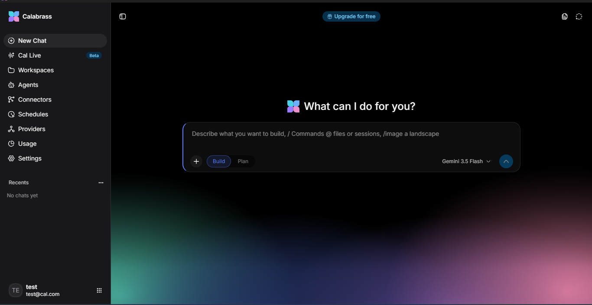

<div align="center">

  

  <br/>
  <br/>
  <br/>

  <p><strong>The open source personal AI agent.</strong></p>

  [](LICENSE)
  
  
  
  
  
  

  [Screenshots](#screenshots) · [Features](#features) · [Quick start](#quick-start) · [Configuration](#configuration) · [Architecture](#architecture) · [Providers](#providers---bring-your-own-keys) · [Tools](#built-in-tools) · [MCP](#mcp-model-context-protocol-host) · [Roadmap](#roadmap)

</div>

---

Calabrass is a **local-first, single-user AI assistant** that runs on your machine. It combines a chat interface, an agent that can use tools (your project files, shell commands, desktop automation through optional connectors), a workspace-aware file context, and a Model Context Protocol (MCP) host. No Calabrass account in the cloud: your chats, files and settings stay on your computer. What you *do* send out is the text of your conversations, to the model provider you choose, and voice audio to the speech provider if you use Cal Live. See [Privacy](PRIVACY.md).

**One host, many faces.** One Calabrass host runs per machine and owns your data, keys, schedules and approvals. The desktop app, the terminal (`cal`) and the web page are all faces of it: they find the host that is already running and share it, so they show the same chats, providers and schedules.

**Each face does what it is best at.** The *desktop app* is your home base: it tells you when the agent is waiting on you or a scheduled run finishes, even with the window minimised; drop a folder on it to work in that folder; `Ctrl+Alt+Space` brings it to the front (Windows). The *terminal* is your workbench: folder-native, scriptable, works over SSH. The *web page* is your control room: the **Ledger** shows what the agent did while you were away, with credentials removed.

**The agent asks before it acts.** It reads and edits files in your project freely. It asks before it runs a command, before it reaches outside the project, and before anything that affects the outside world. See [How permissions work](docs/PERMISSIONS.md).

## 📸 Screenshots

<p align="center">
  
</p>

---

## ✨ Features

### 💬 Chat & Composer
- Streaming replies over Server-Sent Events — tokens appear as they are generated.
- **Reasoning / thinking** streamed on its own channel, rendered inline with a clean trace UI.
- **Model picker** shows live models from every provider you configure — always up to date.
- Auto-generated chat titles from the first user message.
- Per-chat model selection; switch mid-conversation.

## 🛠️ Built-in Tools

### 🤖 Agent & Tools
- Built-in tools: `read_file`, `list_dir`, `glob`, `grep`, `create_dir`, `write_file`, `edit_file`, `edit_lines`, `run_command`, `read_skill`, plus asking you questions and scheduling a task. File tools are confined to the workspace folder; `run_command` is not (see [permissions](docs/PERMISSIONS.md)).
- Web search, fetching a URL and opening apps come from connectors (the optional `win-control` server, or any MCP server you add), not from the core.
- **Agent loop** plans, calls tools, and iterates until the task is done.
- **Approvals** — running a command asks you first; you can allow it once, allow that kind of command in this project, or allow commands for the session. Anything that reaches outside the project, or acts on the outside world, asks every time.
- **Workspaces** — point the agent at a folder and it reads/writes files there with full context.
- **Schedules** — one-time tasks that run the agent at a set time, unattended. A scheduled task may read and edit files in its project, and run only the commands you list when you create it. (Recurring schedules are not built yet.)

## 🔌 MCP Connectors

### 🔌 MCP (Model Context Protocol) Host
- Starts and manages MCP servers as child processes.
- **Bundled servers ship with the installer** (opt-in, off by default):
  - `excel-mcp` — create, read, and modify Excel workbooks.
  - `win-control-mcp` — window management, keyboard/mouse automation, screenshots.
- Add your own MCP servers by path; they appear in the Connectors page, one click to enable.

## 🔑 Providers — Bring Your Own Keys
- **No built-in providers, no keys in the repo.** Add any OpenAI-compatible endpoint (Groq, OpenAI, Together, local vLLM/Ollama, etc.) or Google Gemini (native adapter).
- Provider rows live in your account's SQLite database — fully isolated per user. **API keys are encrypted at rest** under a master key held by your operating system (Windows DPAPI, the macOS Keychain, or the Linux Secret Service; an owner-only key file where there is none), and are never sent back to the web page: you can replace or remove a key, not read it.
- Turn providers on/off without deleting them; models disappear from the picker instantly.
- Groq endpoint automatically gets `max_completion_tokens` and the reasoning-content fix.
- Gemini endpoint uses the native Generative Language API.

### 🗣️ Cal Live (Voice)
- Real-time speech-to-text via Mistral or Groq Whisper.
- Push-to-talk or voice-activity detection.
- Transcripts land in the chat composer, ready to send.

### 💾 Data Ownership & Privacy
- **Everything yours stays in `%LOCALAPPDATA%\Calabrass`** (Windows) or the platform config folder:
  - `calabrass.db` — chats, messages, providers, connectors, agents, schedules, usage.
  - Workspace folders the agent creates.
  - `desktop.log` — structured JSONL logs.
- **Nothing user-made is ever written into the source checkout.** Clone, clean, update, delete the repo — your data is untouched.
- The API listens on `127.0.0.1:8787` only. The host **refuses to start** on any other address unless you set `CALABRASS_PAIRING_CODE` (16+ characters); other devices must then present that code, and still cannot create accounts. Web pages from other sites are refused.
- Read what leaves your machine, and what does not, in [PRIVACY.md](PRIVACY.md).

### 🖥️ Native Windows Installer
- Per-user install — **no UAC prompt**.
- Wizard: welcome → MIT licence → install folder → Start Menu folder → optional desktop shortcut + bundled MCP servers → ready → install → finish with "Launch Calabrass" tickbox.
- WebView2 runtime check; offers Microsoft download page if missing.
- Uninstall asks before touching `%LOCALAPPDATA%\Calabrass` (keeps it by default).
- `excel-mcp.exe` and `win-control-mcp.exe` installed beside the app, built as GUI subsystems (`-H=windowsgui`) — **no blank console windows**.
- SHA256: `767b9ebadd99f0b6e66076cdf52b492119c65d46533bab26f102899b7eb99ff8`

---

## 🚀 Quick Start

### Option A — Install the built app (recommended)
1. Download **`Calabrass-setup-v1.0-x64.exe`** from [Releases](https://github.com/CodewithMubasher/Calabrass/releases).
2. Run it. Windows SmartScreen may warn "Windows protected your PC" (not code-signed yet) → **More info → Run anyway**.
3. On first launch, click **Sign up**, create your account, then open **Providers** and add at least one provider (base URL + API key).
4. Start chatting.

### Option B — Install the terminal app (npm)
```bash
npm install -g calabrass
cal
```
`cal` is the terminal client, and the folder you start it in is the workspace.
It finds the Calabrass host that is already running (the desktop app starts one)
and uses it; if there is none, it starts one in the background. It signs in as
the machine's owner, so the sessions, providers and schedules are the same as in
the desktop app and the web page. Closing the terminal leaves the host running,
so scheduled tasks still happen.

```bash
cal status      # is the host running, and who started it
cal stop        # stop it (scheduled tasks stop with it)
```

### Scripts and CI: `cal run`

One task, no screen. The answer goes to stdout, progress to stderr, and the exit code says how it ended:

```bash
git diff | cal run "write a commit message for this"
cal run "make the failing tests pass" --allow "npm test"
```

It can read and edit files in the folder and run only the commands you `--allow`; it exits `3` if it needed something it was not given. See [Using Calabrass in scripts and CI](docs/CI.md).

If you used an earlier version, `cal` keeps using the separate account it made
for itself, so your old terminal sessions stay visible. To switch to the owner
account, delete `tui.json` from the Calabrass settings folder.

### The web page

The host serves the web interface itself, so there is nothing else to install or
run: with Calabrass running, open <http://127.0.0.1:8787>. (This needs a build that
includes the web interface; the installer and the npm package do.)

### Option C — Run from source (development)
```powershell
# 1. Frontend deps
cd Frontend; pnpm install

# 2. Run both servers together (Ctrl+C stops both)
.\dev.ps1
```
- Frontend: http://localhost:5173
- Backend API: http://127.0.0.1:8787/api

### Desktop development (Wails)
```powershell
# once
go install github.com/wailsapp/wails/v2/cmd/wails@v2.16.0

# live dev with Vite HMR
cd Backend\desktop
wails dev

# production build
wails build
# -> Backend\desktop\build\bin\Calabrass.exe
```

---

## 🏗️ Architecture

## 📁 Repository Structure

```
Calabrass/
├─ Backend/              Go API, SQLite, provider streaming (GoAI SDK)
│  ├─ internal/ai/       Provider registry, model catalog, GoAI adapters
│  ├─ internal/httpapi/  REST + SSE endpoints, auth, connectors, voice
│  ├─ internal/store/    SQLite schema, migrations, queries
│  ├─ internal/connectors/  MCP server pool, bundled server registry
│  └─ desktop/           Wails v2 shell (Go + embedded React)
├─ Frontend/             React 19 + Vite + Tailwind v4 + Base UI
├─ TUI/                  Go terminal client (`cal`), Bubble Tea
├─ npm-wrapper/          npm package `calabrass` → installs the `cal` binary
├─ MCP/                  MCP server sources (excel, win-control)
├─ installer/            Inno Setup script + build script
├─ dev.ps1 / dev.cmd     One-command dev stack
└─ LICENSE               MIT
```

---

## 🔧 Configuration

No `.env` required for providers — add them in the UI.  
Optional backend settings via `%LOCALAPPDATA%\Calabrass\.env` (see `Backend/.env.example`):

```
CALABRASS_ADDR=127.0.0.1:8787          # API listen address (loopback only unless paired)
CALABRASS_PAIRING_CODE=...              # lets other devices connect; needed for any non-loopback address
CALABRASS_DATA_DIR=...                  # use a different data folder (and so a separate host)
CALABRASS_BACKGROUND=off                # desktop: host in the window instead of a background process
CALABRASS_DB=calabrass.db               # DB filename (inside data folder)
MISTRAL_API_KEY=...                     # For Cal Live (optional)
CALABRASS_VOICE_PROVIDER=mistral        # or "groq"
CALABRASS_VOICE_MODEL=voxtral-mini-latest
CALABRASS_SYSTEM_PROMPT=...             # Global system prompt override
CALABRASS_WORKSPACES_DIR=workspace      # Subfolder inside data folder
CALABRASS_QUOTAS=model_free_tier_quotas.md  # Free-tier limits file (your edits are kept; the shipped copy is model_free_tier_quotas.default.md)
```

---

## 🧱 Tech Stack

| Layer | Technology |
|-------|------------|
| Frontend | React 19, Vite, Tailwind CSS v4, Base UI, TanStack Router, TanStack Query |
| Backend | Go 1.26, SQLite (modernc.org/sqlite), GoAI SDK, Server-Sent Events |
| Desktop | Wails v2 (native WebView2 window) |
| MCP | Official Go MCP SDK, stdio transport |
| Auth | bcrypt (default cost), 30-day bearer tokens, SHA-256 token storage |
| Logging | slog JSONL to `%LOCALAPPDATA%\Calabrass\desktop.log` |

---

## 🗺️ Roadmap

- [ ] Code-signed installer (remove SmartScreen warning)
- [ ] macOS / Linux builds (Wails supports them)
- [ ] Plugin system for custom tools
- [ ] Shared workspace collaboration (opt-in, local network)
- [ ] Recurring schedules; a run ledger; a system-tray icon for the background host
- [ ] Agent memory / long-term context across sessions
- [ ] More bundled MCP servers (browser, database, git)

---

## 📄 License

MIT — see [LICENSE](LICENSE).  
Copyright (c) 2026 Mubasher Chaudhary.

---

## 🙏 Acknowledgements

- [GoAI](https://github.com/zendev-sh/goai) — unified provider interface
- [Wails](https://wails.io/) — Go + WebView2 desktop apps
- [MCP](https://modelcontextprotocol.io/) — Model Context Protocol
- [Base UI](https://base-ui.com/) — unstyled, accessible React components
- [shadcn/ui](https://ui.shadcn.com/) — Trace component for reasoning display
